# Database Design — Lab Metadata System

This document specifies the PostgreSQL schema that implements the append-only
event log, artifact index, and provenance DAG described in
[overview.md](overview.md). It is the authoritative reference for the schema:
an ER overview, a table-by-table rationale, and the recursive lineage query. The
complete runnable DDL lives alongside it in [schema.sql](schema.sql).

- **Target:** PostgreSQL 14+ (schema named `lab`).
- **Portability:** the schema degrades cleanly to SQLite for single-writer use;
  the deltas are listed in [Portability](#portability-notes).

---

## 1. Overview & ER diagram

The schema has eight layers:

1. **Reference tables** — mostly-static vocabulary and registries (`person`,
   `probe`, `pipeline`, `storage_root`, `species`, and the categorical lookups
   `event_type` / `artifact_role` / `acquisition_system`).
2. **Projects** — `project`, its membership (`project_member`) and its
   attachments (`project_artifact`). Unlike everything below, these rows are
   deliberately **mutable**: people join and leave, documents get revised.
3. **Dimensions** — the durable identities the events hang off: `subject` (the
   animal) and `session` (a recording period, 1:1 with a NAS folder).
4. **Events** — a base `event` table plus one typed detail table per event type
   (class-table inheritance). Events are immutable and append-only.
5. **Artifacts & provenance** — `artifact` rows point at the event that produced
   them; `event_input` records which artifacts an event consumed. Together these
   two edge types form the provenance DAG.
6. **Tags** — a vocabulary of `namespace:value` labels (`tag_namespace`, `tag`)
   and an append-only log (`tag_assignment`) of which labels were put on which
   event, artifact, subject, session or project. Current tags are derived from
   the log by a view (§3.7).
7. **Variables** — user-defined named values (`probe depth` = 1250 µm on a
   session): definitions (`variable`) and an append-only log of values set
   and unset (`variable_value`), with current values derived by a view
   (§3.8). Same shape as tags.
8. **Forms** — named, reusable data-entry templates (`form`, with immutable
   versions in `form_version`), put to use for a subject in a project
   (`subject_form`); each entry made on one is an `observation` event whose
   values are variables on the event (§3.9).

Alongside the event log, `retraction` records events and artifacts withdrawn
as entered in error (§4.3).

```mermaid
erDiagram
    project      ||--o{ project_member   : has
    project      ||--o{ project_artifact : collects
    project      ||--o{ subject          : groups
    person       ||--o{ project_member   : joins
    person       ||--o{ event            : records
    person       ||--o{ surgery_event    : performs
    species      ||--o{ subject          : classifies
    storage_root ||--o{ session          : roots
    storage_root ||--o{ artifact         : roots
    probe        ||--o{ surgery_event    : implanted_in
    probe        ||--o{ recording_event  : used_by
    pipeline     ||--o{ analysis_event   : run_as

    subject      ||--o{ session          : has
    subject      ||--o{ event            : subject_of
    session      ||--o{ event            : groups

    event_type   ||--o{ event            : typed_as
    event        ||--|| birth_event      : detail
    event        ||--|| surgery_event    : detail
    event        ||--|| recording_event  : detail
    event        ||--|| behavior_event   : detail
    event        ||--|| husbandry_event  : detail
    event        ||--|| endpoint_event   : detail
    event        ||--|| histology_event  : detail
    event        ||--|| analysis_event   : detail
    event        ||--|| observation_event : detail
    event        |o--o{ event            : supersedes

    event        ||--o{ artifact         : produces
    event        ||--o{ event_input      : consumes
    artifact     ||--o{ event_input      : consumed_by
    artifact     |o--o{ artifact         : supersedes
    artifact     ||--o{ artifact_verification : verified_by
    artifact_role||--o{ artifact         : role

    tag_namespace||--o{ tag              : contains
    tag          ||--o{ tag_assignment   : applied_as
    person       |o--o{ tag_assignment   : applied_by
    event        |o--o{ tag_assignment   : tagged
    artifact     |o--o{ tag_assignment   : tagged
    subject      |o--o{ tag_assignment   : tagged
    session      |o--o{ tag_assignment   : tagged
    project      |o--o{ tag_assignment   : tagged

    variable     ||--o{ variable_value   : valued_as
    event        |o--o{ variable_value   : carries
    artifact     |o--o{ variable_value   : carries
    subject      |o--o{ variable_value   : carries
    session      |o--o{ variable_value   : carries
    project      |o--o{ variable_value   : carries
    event        |o--o| retraction       : withdrawn_by
    artifact     |o--o| retraction       : withdrawn_by

    form         ||--o{ form_version     : published_as
    form_version ||--o{ subject_form     : pinned_by
    subject      ||--o{ subject_form     : uses
    project      ||--o{ subject_form     : in
    subject_form ||--o{ observation_event : entries
    form_version ||--o{ observation_event : made_on
```



---

## 2. Conventions

- **Identifiers.** `event` and `artifact` use `uuid` primary keys defaulting to
  `gen_random_uuid()`. UUIDs could be minted by a client before the row is
  written, and two workstations would never collide; the MATLAB `CarasLabDB`
  class does not do this today and takes each new id from the insert's
  `RETURNING` clause. `subject` uses its human-meaningful lab ID as a
  natural text primary key; lookup tables use short `code` primary keys.
- **Two clocks.** Every event carries `occurred_at` (when the fact happened in
  the lab) *and* `recorded_at` (when the row was inserted). They differ whenever
  metadata is entered after the fact, which is the norm.
- **Categoricals are lookup tables, not native enums.** `event_type`,
  `artifact_role`, and `acquisition_system` are small tables referenced by FK.
  This keeps the vocabulary extensible without `ALTER TYPE`, and it is the
  portable choice for SQLite. Tiny fixed sets that will never grow (`sex`,
  `checksum_algo`, `modality`, `status`) use `CHECK` constraints instead.
- **Extensibility.** The base `event` and `artifact` tables each carry an
  `attributes jsonb` column for ad-hoc fields that do not warrant a schema
  change. Structured, frequently-queried data gets real columns
  (`analysis_event.parameters`, `recording_event.hardware_config`,
  `probe.geometry` are the JSONB exceptions where the shape is genuinely open).
  Named values that lab members want to set, read and compare, with units
  and history, are variables (§3.8) rather than `attributes` keys.
- **Timestamps** are `timestamptz`; store UTC. **Text** uses `text`, not
  `varchar(n)`.
- **Everything is schema-qualified** (`lab.<table>`) so the DDL is
  copy-paste-safe regardless of the caller's `search_path`.

---

## 3. Table reference

### 3.1 Reference tables

| Table | Purpose |
|---|---|
| `person` | Lab members. Referenced by `event.recorded_by`, `surgery_event.surgeon_id`, and every `*_by` column. `db_login` names the database login the person connects with (unique where set); `lab.fn_current_person()` maps the connected login back to the person (§4). Only the administrator sets it: `grants.sql` withholds the column, and `UPDATE` on the table, from `lab_rw`. |
| `storage_root` | Named NAS roots. Paths elsewhere are stored **relative** to a root so they resolve across machines/OSes; the per-OS mount point lives in client config, not the DB. |
| `species` | Species vocabulary for `subject`. |
| `probe` | Electrode/probe device registry, including channel geometry as JSONB. Referenced by surgeries (implant) and recordings (acquisition device). |
| `pipeline` | Analysis pipeline registry (name + repo). Each *run* pins its own `code_version`/`parameters` on the `analysis_event`, so this table stays stable while runs vary. |
| `event_type` | The nine event-type codes; the discriminator that selects a detail table. |
| `artifact_role` | Role a file plays (`raw`, `spikes`, `lfp`, `video`, `figure`, …). |
| `acquisition_system` | Acquisition software (`intan_rhx`, `open_ephys`). |

### 3.2 Projects

| Table | Purpose |
|---|---|
| `project` | The unit of work a subject belongs to. `subject.project_id` is `NOT NULL`, so every animal has exactly one. |
| `project_member` | Many-to-many `project`↔`person`, with a `role` (`PI`, `lead`, `analyst`, …). |
| `project_artifact` | Project-level attachments — NAS files *and* external references (Google Docs/Sheets, arbitrary URLs). Distinct from the provenance `artifact` table: these are reference material, not checksummed data files produced by an event. A `CHECK` enforces that `kind = 'file'` rows are located by (`storage_root_id`, `relative_path`) and every other kind by `uri`, never both. |

These three tables are the schema's mutable layer. They are intentionally
**not** covered by the append-only triggers in §4: membership and documents are
current-state facts, not a log of events. Every change to them is still
recorded, with its previous value, in `row_history` (§3.6).

### 3.3 Dimensions

**`subject`** — the animal, keyed by lab ID. Its identity is independent of any
birth: an acquired animal has a `subject` row with `date_of_birth` possibly null
and no `birth_event`. Descriptive fields (`species_code`, `sex`, `strain`,
`genotype`, `source`) live here because they are stable identity attributes;
anything that *happens* to the subject over time is an event.

**`session`** — a recording period mapping 1:1 to a NAS folder `subject/session`.
`UNIQUE(subject_id, label)` and `UNIQUE(storage_root_id, relative_path)` enforce
that mapping. Recording and behavior events belong to a session; births,
surgeries, and husbandry do not.

### 3.4 Events (class-table inheritance)

**`event`** is the base row shared by all event types. It holds the common
columns — type, subject, session, the two clocks, recorder, correction link,
notes, and the `attributes` JSONB — and nothing type-specific.

Type correctness is enforced **declaratively**, not by trigger: `event` carries
`UNIQUE(event_id, event_type)`, and every detail table pins its own type with a
`CHECK` plus a composite foreign key `(event_id, event_type) →
event(event_id, event_type)`. A `recording_event` row therefore *cannot* attach
to an event whose type is `birth`.

Detail tables and their type-specific columns:

| Detail table | Key columns |
|---|---|
| `birth_event` | `dam_subject_id`, `sire_subject_id`, `litter_id`, `birth_weight_g` (newborn = base `subject_id`) |
| `surgery_event` | `procedure`, `surgeon_id`, `anesthesia`, `target_region`, `hemisphere`, stereotax `ap/ml/dv_mm`, `probe_id`, `outcome` |
| `recording_event` | `acquisition_system_code`, `probe_id`, `modality`, `sample_rate_hz`, `n_channels`, `duration_s`, `stimulus_protocol`, `hardware_config` |
| `behavior_event` | `task`, `paradigm`, `stage`, `trials_completed`, `performance`, `reward` |
| `husbandry_event` | `measure`, `weight_g`, `water_ml`, `health_status` |
| `endpoint_event` | `method`, `perfusion_fixative`, `tissue_collected`, `disposition` |
| `histology_event` | `technique`, `target_region`, `stain`, `microscope` |
| `analysis_event` | `pipeline_id`, `pipeline_name`, `code_version`, `parameters`, `environment`, `started_at`, `finished_at`, `status` |
| `observation_event` | `subject_form_id`, `form_name`, `form_version`, `session_label` — an entry made on a form; its values are variables on the event (§3.9) |

Every event except an `analysis` run names a subject
(`event_subject_required_ck`). An analysis may span several animals; any other
event without a subject is an entry error that every per-subject view would
silently drop.

Rules that need a trigger rather than a constraint:

- **Recordings require a session.** `trg_require_session_for_recording` rejects a
  `recording_event` whose base `event.session_id` is null. (Behavior events may
  belong to a session but are not *required* to — not every training run
  produces a NAS folder.)
- **Corrections preserve the event type.** `trg_event_supersede_same_type`
  rejects an event that supersedes one of a different type. Without it a
  `recording` could be replaced by a `birth`, silently retyping history and
  stranding the original detail row.
- **`subject_id` is derived from the session when omitted.**
  `trg_event_fill_subject` fills it in, which is what makes the composite FK
  below bite (see "Subject/session agreement").
- **Immutability.** `event`, every `*_event` detail table, `artifact`,
  `event_input` and the audit logs reject `UPDATE`/`DELETE`/`TRUNCATE` (see §4).

**Subject/session agreement.** `event` and `artifact` each carry a composite
foreign key `(session_id, subject_id) → session(session_id, subject_id)`. An
event therefore cannot be filed under animal A while pointing at a session
belonging to animal B — a row that looks perfectly fine in isolation but
quietly corrupts every per-subject rollup. This is the same declarative trick
as `(event_id, event_type)`, and it needs the `UNIQUE (session_id, subject_id)`
on `session` as its target.

**Video.** Behavioral video is not a separate event type; it is an `artifact`
with `role = 'video'`. A recording that is primarily video sets
`recording_event.modality = 'video'` (or `'multimodal'` when video accompanies
ephys), and the `.mp4`/`.avi` files register as artifacts of that event.

### 3.5 Artifacts & provenance

**`artifact`** — one row per file on the NAS, referenced by
`(storage_root_id, relative_path)` plus a `checksum`. It always points at the
`produced_by_event_id` that created it. The same bytes at the same path can be
registered only once: `uq_artifact_file_original` makes
`(storage_root_id, relative_path, checksum)` unique among original
registrations, and `trg_artifact_unique_active` rejects a second *active* row
for one file. A re-derived file at the same path (new bytes) registers as a
new artifact, optionally linked to the old one via `supersedes`. A correction
may repeat the file identity of the row it supersedes, which is what lets an
artifact be re-pointed at a corrected event (§4.2) or have its role, format,
session or attributes fixed. A table-wide `UNIQUE` on those three columns
would forbid both.

**`event_input`** — the second edge type: the artifacts an event consumed. It is
general (any event may consume artifacts) but in practice is populated by
analysis events. `artifact.produced_by_event_id` + `event_input` are the two
edges of the provenance DAG. `trg_event_input_acyclic` keeps it a DAG: an
event cannot consume an artifact that already derives from that event (found
by walking `fn_artifact_lineage(…, 'up')`, to the same depth cap of 64). The
walk is made twice, over the rows as recorded and with every node resolved to
its current version (§5), because a correction can close a loop in the second
graph that the recorded rows do not contain. Edge inserts are serialised by a
transaction-level advisory lock, so two concurrent transactions cannot each
add one half of a loop.

**An artifact is filed with the event that produced it.**
`trg_artifact_matches_event` rejects an artifact whose `subject_id` or
`session_id` differs from its producing event's. Either side may leave one
unset (a cross-animal analysis has no subject), but where both name a subject
or a session they must agree; otherwise a file is listed under animal A while
its recording is about animal B. Rows that predate the trigger are reported
as `artifact_event_mismatch` (§4.2).

**`artifact_verification`** — an *append-only log* of integrity checks. Because
`artifact` rows are immutable, periodic checksum re-verification is recorded here
(`ok` / `missing` / `mismatch`) instead of mutating the artifact. A `mismatch`
must carry the `observed_checksum`, since that is the only thing that makes the
row actionable.

**Verification belongs to the file, not to the artifact row.** A correction
inserts a new artifact row for the same `(storage_root_id, relative_path,
checksum)`, and a row keyed only by `artifact_id` would then start with a
clean slate: a known `mismatch` would silently become "never verified". The
view `artifact_verification_latest` therefore gives, for every artifact row,
the latest check of its *file* across all rows that describe it
(`verified_artifact_id` is the row the check was recorded against), and
`fn_check_integrity()` reads that view. A correction that changes the path or
the checksum describes a different file and correctly starts unverified.
[`tools/verify_artifacts.py`](../tools/verify_artifacts.py) is the scheduled
job that reads the files on the NAS and writes this log.

**Checksums are format-checked.** `checksum` must be hex of exactly the width
the declared `checksum_algo` produces (`md5` = 32, `sha256`/`blake3` = 64), and
a trigger lower-cases it on insert. Both halves matter: this table exists to
make file integrity *checkable*, so a truncated or placeholder checksum would
make a nightly verifier report `mismatch` forever with no way to distinguish a
corrupted file from a bad registration; and without case normalisation the same
bytes registered as `AB..` and `ab..` are two different rows under the `UNIQUE`
above, defeating the de-duplication it exists for.

**Paths must be genuinely relative.** `session.relative_path`,
`artifact.relative_path` and `project_artifact.relative_path` each reject
absolute paths, drive letters and `..` segments — the things that cannot be
repaired by rewriting. Paths are stored relative to a storage root precisely so
they resolve on every machine that mounts the NAS; an absolute path baked in
from one workstation does not.

Separators are **normalised, not rejected**: a trigger rewrites `\` to `/` on
insert. This lab runs on Windows, where `fullfile()` and every native tool
produce `GERB042\sess01`; storing that alongside a Linux client's
`GERB042/sess01` would put one folder in the table twice and break both the
session-to-folder mapping and artifact de-duplication. Same reasoning as
lower-casing checksums — canonicalise on the way in so one real-world thing is
always one row.

### 3.6 Audit and versioning

**`row_history`** — the previous and new value of every `UPDATE`, and the
removed row of every `DELETE`, on the mutable tables (the reference tables,
the project tables, `subject`, `session`, the tag vocabulary
`tag_namespace` / `tag` and the variable definitions `variable`). Those
tables are edited in place
by design; this table is what keeps such an edit from erasing the old value
and who changed it. It is written by the `SECURITY DEFINER` trigger function
`fn_log_row_change`, so clients need no privilege on it and cannot write it
directly. `changed_by` is `session_user`, the login that connected, which
`SET ROLE` cannot change. Updates that change nothing are not recorded.

**`maintenance_log`** — one row per identity-maintenance operation (§4.1).

**`schema_version`** — one row per applied schema version; the current
version is `max(version)`. `schema.sql` installs the current version
directly. The database has not been launched, so the current schema is
version 1 and changes are made in `schema.sql`. From launch on, an existing
database is upgraded by the scripts in [`migrations/`](migrations/), each of
which records its own row, and a fresh install and an upgraded database end
with identical schemas. The upgrade scripts of the pre-launch numbering are
archived, untested, in [`migrations/pre-launch/`](migrations/pre-launch/).
Both clients read
the version at connect time: the MATLAB class, which writes, refuses to
connect to a version it was not written for (unless told
`AllowSchemaMismatch=true`), and the read-only MCP server attaches a warning
to every result.

All three are append-only (§4).

### 3.7 Tags

Tags are hashtag-style labels — `stage:raw`, `cohort:a`, `qc:fail`, a bare
`auditory_cortex` — on events, artifacts, subjects, sessions and projects, for
the ad-hoc categories that neither `artifact.role` nor free-text `notes` can be
queried by. The user-facing rules (syntax, policy flags, filter grammar,
per-client usage) are in [tagging.md](tagging.md); this section records why the
tables look the way they do.

| Table | Purpose |
|---|---|
| `tag_namespace` | One row per namespace and the policy its tags obey: `mutability` (`mutable`/`immutable`), `cardinality` (`single`/`multi`), `open_vocabulary`, and `applies_to` (a non-empty `text[]` of the five entity kinds). Mutable reference data, edited in place and recorded in `row_history`. |
| `tag` | The registered tags. `tag` is the primary key and always equals `namespace || ':' || value` (`tag_parts_ck`); `value` is regex-checked (`tag_value_ck`), the namespace name by `tag_namespace_name_ck`. A tag is never renamed; it is retired via `retired_at`. Mutable, in `row_history`. |
| `tag_assignment` | The **append-only log** of tags put on (`op = 'add'`) and taken off (`op = 'remove'`) entities. Exactly one of `event_id`, `artifact_id`, `subject_id`, `session_id`, `project_id` is set, matching `entity_kind` (`tag_assignment_entity_ck`, the pattern of `project_artifact_location_ck`); each is a real foreign key. |

**Why a log, and current state as a view.** Tagging is the same shape of
problem as events: something is true from some time until someone says
otherwise, and "who changed `stage` from `raw` to `sorted`, and when" is worth
keeping. So `tag_assignment` follows the schema's own rule — never add a
mutable column where append would do. It is protected by `fn_forbid_mutation()`
(§4), and there is no "current tags" column on any entity. The view
`tag_current` takes the latest row per (entity, tag) by `assignment_id` —
insertion order — and keeps it if it is an `add`; `entity_tags` aggregates
that into sorted arrays per entity. It is deliberately not ordered by
`applied_at`: that is the start time of the writing transaction and can be
supplied by the client, so a `remove` the policy trigger accepted could carry
an earlier `applied_at` than the `add` it removes and would then do nothing.
`display_tag` strips the `tag:` prefix so every client renders bare tags the
same way.

**Why there is no stored `entity_id` column.** An entity-id text column
(`COALESCE(event_id::text, …)`) would be convenient, but renaming a subject
cascades into `tag_assignment.subject_id` (`ON UPDATE CASCADE`), and the
subject-rename hatch in `fn_forbid_mutation()` (§4.1) admits that cascade only if
every column other than the subject-id columns is unchanged. A stored or
generated copy of the id would change with it, and `fn_rename_subject` would
fail for every tagged subject. The id is therefore computed in the views and
functions, and `ix_tag_assignment_entity` is an expression index on that same
`(entity_kind, COALESCE(…))` so the lookups stay indexed; there is one plain
index per id column and `ix_tag_assignment_tag (tag, entity_kind)` as well.
Tags follow a renamed subject for free.

**Policy is enforced in the database, once.** `trg_tag_assignment_policy`
(`BEFORE INSERT`) rejects a tag that is unregistered or retired, a kind outside
`applies_to`, a duplicate `add`, a `remove` of something not current or in an
immutable namespace, and a second value in a `single` namespace.
`trg_tag_normalize` / `trg_tag_assignment_normalize` canonicalise the tag on
the way in (`lab.fn_canonical_tag`: lower case, trimmed, `tag:` prefix when
there is no colon — nothing else is rewritten, the `CHECK`s reject the rest),
the same policy as checksums and paths. `trg_tag_guard` stops a tag being
renamed; `trg_tag_namespace_guard` freezes a namespace's `mutability` and
`cardinality` (and lets `applies_to` only grow) once any of its tags has been
assigned, and freezes the reserved `tag` namespace from the start. That freeze,
not an admin gate, is what prevents policy drift: any `lab_rw` member may create
a namespace, since the flags are editable by members anyway and a gate would be
theatre. The checks are trigger-based, so — like `trg_artifact_unique_active`
— they are made safe under concurrent writers by a transaction-level advisory
lock, here on (entity, namespace): without it two sessions could each pass the
single-cardinality check and both commit, which in an immutable namespace
could never be repaired. `fn_check_integrity()` reports any such state as
`tag_cardinality_violation` ([tagging.md](tagging.md) §9).

**Write and read functions.** `lab.fn_tag` is the one write path every client
uses: it canonicalises, auto-registers a new value in an open namespace, and
replaces the current value in a mutable single-valued namespace as a `remove`
plus an `add` in one call. `lab.fn_register_tag` registers without applying.
`lab.fn_tag_match` is the single definition of filter semantics (all / any /
none, `ns:*` wildcard, bare tokens, empty list = no constraint), shared by the
MATLAB getters, the GUI and the MCP server; `lab.fn_find_by_tags` wraps it.
`fn_tag_match` treats a token nothing carries as simply unmatched, which is
right for matching but makes a typo silent (`NotTags="qc:fial"` excludes
nothing), so `lab.fn_tag_filter_problems(kind, tokens)` reports an unknown
namespace, an unregistered tag, or a namespace that does not apply to the
entity kind, and the clients call it once per query and refuse the filter.
Function ACLs are deliberately not set in `schema.sql`, so `lab_rw` and `lab_ro`
both keep the default `EXECUTE`, and `lab_ro` is stopped at the `INSERT`.

**Corrections.** Tags belong to a row, so a superseding event or artifact
starts without its predecessor's tags and would vanish from every tag filter.
The MATLAB class copies the current tags forward as new `add` rows in the same
transaction (retired tags are skipped with a warning); a correction written in
raw SQL must do the same ([tagging.md](tagging.md) §8), and
`fn_check_integrity()` reports a miss as `tag_not_carried_forward` (§4.2).

**Seed vocabulary.** `tag` (bare tags; reserved), `stage` (closed; `raw`,
`preprocessed`, `sorted`, `curated`, `analyzed`), `qc` (closed; `pending`,
`pass`, `fail`), `cohort` and `condition` (immutable, open) and `topic` (multi,
open). `stage` is where an artifact is in the pipeline and changes;
`artifact.role` is what the file is and is fixed at registration.

### 3.8 Variables

Variables are named values — `probe depth` = 1250 µm on a recording session,
`housing` = `pair` on an animal — on the same five entity kinds as tags, for
the measurements and settings no fixed column anticipates. The user-facing
rules are in [variables.md](variables.md).

| Table | Purpose |
|---|---|
| `variable` | One row per variable: `name` (primary key; lower-case words separated by single spaces, `variable_name_ck`), `label`, `description`, `units`, `value_type` (`number`/`text`), `applies_to` (a non-empty `text[]` of the five kinds), `retired_at`. Mutable, recorded in `row_history`; `lab_rw` may insert and update it. |
| `variable_value` | The **append-only log** of values set (`op = 'set'`) and cleared (`op = 'unset'`). Exactly one entity id column matches `entity_kind`, as in `tag_assignment`; a `set` row carries exactly one of `value_num` (`numeric`) / `value_text` (`variable_value_single_ck`), never NaN or infinity, never blank text. `set_at`, `set_by`, `set_login`, `note`. |

**Same shape as tags, for the same reasons.** A value is true from when it is
set until someone sets another, and "what was the depth before it was
corrected, and who changed it" is worth keeping, so values are a log
protected by `fn_forbid_mutation()` and there is no value column on any
entity. `variable_current` takes the latest row per (entity, variable) by
`value_id` (insertion order, not `set_at`, for the reason given for
`tag_current`) and keeps it if it is a `set`; `entity_variables` aggregates
an entity's current values into one `jsonb` object. There is no stored
`entity_id`, for the subject-rename reason of §3.7, and the indexes mirror
`tag_assignment`'s.

**Policy in the database.** `trg_variable_value_policy` (`BEFORE INSERT`)
rejects a value for an undefined variable, for a kind outside `applies_to`,
of the wrong type, or an `unset` with nothing to unset; it serialises
writers per (entity, variable) with a transaction-level advisory lock.
`trg_variable_normalize` canonicalises a new definition (name, a label
defaulting to the name, blank units as NULL). `trg_variable_guard` forbids
renaming a variable and, once it has any value, freezes `value_type` and
`units` and lets `applies_to` only grow: the units are part of what every
stored value means.

**Write and read functions.** `lab.fn_set_variable(kind, id, name, p_number
| p_text, p_units, p_label, p_description, p_note, p_by)` is the one write
path: it canonicalises the name, defines the variable on first use (type
from the value given), refuses units that differ from the definition and a
retired variable, and appends a `set`. `lab.fn_unset_variable` appends an
`unset`; `lab.fn_define_variable` defines without setting; and
`lab.fn_variable_number` / `lab.fn_variable_text` return one current value
for use inside an ordinary query. All of them run with the caller's
privileges, so `lab_ro` is stopped at the `INSERT`.

**Corrections carry variables, in the database.** Unlike tags, which the
MATLAB class carries, `trg_event_carry_variables` /
`trg_artifact_carry_variables` (`AFTER INSERT`, through
`lab.fn_carry_variables`) copy the predecessor's current values onto a
superseding row, keeping each value's `set_at` and `set_by`, so every client
and a correction typed into psql behave the same.

**Attribution.** `set_login` is stamped by `trg_variable_value_stamp_login`
like the other `*_login` columns (§4). `set_by` is filled with
`fn_current_person()` by the write functions, not by the trigger, so a
carried-forward value keeps the `set_by` it had.

### 3.9 Forms

A form is a data-entry page for one session of one subject, built in the
browser (`web/forms/`). The user guide, the definition format and the server
are in [forms.md](forms.md); this is the data model.

| Table | Purpose |
|---|---|
| `form` | A **template**: `name` (primary key, the variable-name rule, never changes: `trg_form_guard`), `label`, `description`, `retired_at`. Mutable, recorded in `row_history`; `lab_rw` may update `label`, `description` and `retired_at` only. |
| `form_version` | The template's content, **append-only**: `(form_name, version)`, `definition` (`jsonb`), `note`, `created_by`, `created_login` (stamped). `trg_form_version_policy` numbers versions 1, 2, … under a per-template advisory lock and refuses a definition `lab.fn_form_definition_problems` faults, so a raw `INSERT` is held to the same rules as `lab.fn_publish_form`. |
| `subject_form` | A template **put to use for one subject in one project** (by default the subject's own; a subject used in another project has its forms there). `UNIQUE (subject_id, project_id, form_name)`. `form_version` is the version new entries use, moved to a newer one explicitly. Mutable (`form_version`, `notes`, `retired_at`) and recorded in `row_history`; `trg_subject_form_guard` keeps the subject, project and template fixed (a subject rename's cascade excepted). |
| `observation_event` | Detail row of an **entry**: which subject form, template and version it was made on, and the session's free-text `session_label`. The `(subject_form_id, form_name)` FK ties the entry's template to the subject form's; `trg_observation_event_policy` ties its subject (on `event`) to the subject form's. |

**An entry is an event.** When the session happened is `event.occurred_at`,
who entered it `recorded_by` / `recorded_login`; a correction supersedes it
and `lab.fn_retract` withdraws it, exactly like any other event. A session
here is a label and a time, not necessarily a `lab.session` folder;
`event.session_id` links one when there is one.

**Its values are variables on the event.** Each field of a template is bound
to a `lab.variable` (numbers for the number and integer widgets, text for the
others), so values are typed, unit-checked, append-only and login-stamped,
and a correction carries them forward by `trg_event_carry_variables`. The
note every entry has is the reserved text variable `entry note`; it can be
changed later (`lab.fn_set_entry_note`) without a correction, and every
earlier text stays in the log.

**Values are kept as typed.** `lab.fn_record_observation` takes each value as
the text the user typed (a JSON string; a JSON number is refused) and
accepts a number only in the form `numeric` gives back unchanged, so `1.50`
is stored and shown as `1.50` and `1e3`, `.5` or `007` are refused with the
reason rather than rewritten (`lab.fn_form_number_ok`,
`lab.fn_observation_problems`).

**Written once, sent many times.** The browser mints the entry's event id and
keeps the entry until the server confirms it. `lab.fn_record_observation`
stores a digest of the entry in `event.attributes.client_digest`: the same
id with the same digest is `existing` and writes nothing (checked before
anything else, so an entry already stored is never refused on replay);
another digest is SQLSTATE `CLB01`. Value problems are `CLB02` with the
problems as JSON in `DETAIL`; correcting an entry that has already been
corrected is `CLB03`.

**Write and read functions.** `lab.fn_publish_form` (defines the fields'
variables, appends a version unless the definition is unchanged),
`lab.fn_add_subject_form`, `lab.fn_record_observation` (an entry or its
correction, in one transaction: the correction keeps the subject form and
version, sets changed values, unsets cleared ones, carries tags),
`lab.fn_set_entry_note`; `lab.observation_active` (active entries with their
values as stored text, and `entry_id`, the id of the first version, which
corrections keep) and `lab.fn_subject_project_columns` (the column order of
a subject's CSV for a project). All run with the caller's privileges.

---

## 4. Immutability & corrections

Events are facts; facts do not change. The schema forbids `UPDATE` and `DELETE`
on all event and artifact tables, `event_input`, and the logs
`artifact_verification`, `maintenance_log`, `row_history`, `schema_version`,
`tag_assignment`, `variable_value` and `retraction` via `fn_forbid_mutation()`. A mistake is fixed
by **appending a superseding row** whose `supersedes` points at the row it
replaces. The partial unique index on `supersedes` keeps history *linear* — a
given row can be corrected by at most one successor, so there are no forks.

`TRUNCATE` is blocked separately. It bypasses row-level triggers entirely, so
the `BEFORE UPDATE OR DELETE ... FOR EACH ROW` trigger does **not** stop it —
a single `TRUNCATE lab.event CASCADE` would silently erase the whole log and
everything hanging off it. Each protected table therefore also carries a
`BEFORE TRUNCATE ... FOR EACH STATEMENT` trigger (statement level, because
`FOR EACH ROW` is not permitted for `TRUNCATE`).

`event_input` is append-only too, but it has no `supersedes` column, so a
mis-recorded input is corrected by superseding the *consuming event* and
re-declaring its inputs. `fn_forbid_mutation()` says so in its error message
rather than giving the generic "insert a superseding row" advice that cannot be
followed there.

A row is **active** when nothing supersedes it and it has not been
retracted (§4.3). The `event_active` and `artifact_active` views encapsulate
that filter so callers never hand-roll it. `event_version` and
`artifact_version` are the full-history counterparts: every row, with
`superseded_by`, `is_retracted` and `is_current` (false for a superseded or
a retracted row), so that a reader of history cannot mistake a row that is no
longer in force for a current one. `fn_event_current` /
`fn_artifact_current` return the current version of any row, and
`fn_event_versions` / `fn_artifact_versions` its whole chain.

**Who wrote a row.** `recorded_by`, `created_by`, `verified_by`,
`applied_by`, `retracted_by` and `set_by` name a *person*. The database also
records the *login* that was connected, in `event.recorded_login`,
`artifact.created_login`, `artifact_verification.verified_login`,
`tag_assignment.applied_login`, `retraction.retracted_login` and
`variable_value.set_login`: `trg_*_stamp_login` sets each to `session_user`
whatever the client sends, the same guarantee `row_history` gives for the
mutable tables. With one login per lab member that identifies the writer
without client cooperation; with a shared login it identifies nobody. Only
rows written before pre-launch schema version 4 have `NULL`.

The two are tied by `person.db_login`: `lab.fn_current_person()` returns the
person whose `db_login` is the connected login (NULL for a login mapped to
nobody, such as a service login). Where the client names no person,
`trg_*_stamp_login` fills the person column with it (and
`fn_set_variable` / `fn_unset_variable` / `fn_define_variable` do for
variables); a person the client does name is kept, because entering a record
on someone's behalf is legitimate and the login column says who typed it.
The MATLAB class uses the same function to resolve its current person. `recorded_at` and
`created_at` default to the insert time but may be supplied (the MATLAB class
exposes `RecordedAt=`), so they are the client's statement, not the
database's.

**Trigger functions pin their `search_path`.** A subject rename (§4.1)
cascades into the append-only tables, and PostgreSQL runs a cascaded `UPDATE`
— and the triggers it fires — as the *owner* of the referencing table, while
an unpinned function resolves names with the *caller's* search path, in which
`pg_temp` comes first for type names. A client able to start the cascade
could therefore have had its own code run as the owner. Every trigger
function is declared `SET search_path = pg_catalog, pg_temp` and refers to
`lab` objects by qualified name; `tests/roles_test.sql` asserts both. For the
same reason the schema should be owned by a dedicated non-superuser role, not
by `postgres`.

### 4.1 The one sanctioned mutation: renaming a subject

`subject_id` is a human-typed natural key, and humans mistype it. Because it is
*the* key, correcting a typo means updating every FK that points at it — and
those land in append-only tables. Without an explicit path a mistyped animal ID
would be **permanently uncorrectable**: the referencing rows can be neither
updated nor deleted, and creating the correctly-named subject strands that
animal's history under the wrong ID forever.

So the FKs to `subject(subject_id)` declare `ON UPDATE CASCADE`, and
`lab.fn_rename_subject(old, new)` performs the rename behind transaction-local
settings (`lab.maintenance`, `lab.rename_from`, `lab.rename_to`) that
`fn_forbid_mutation()` honours for `UPDATE` only — never `DELETE`, never
`TRUNCATE`. Any session can set a custom setting, so the flag alone is not
trusted: under it, an `UPDATE` passes only if every column other than the
subject-id columns is unchanged, each changed subject-id column went from
`rename_from` to `rename_to`, the old id no longer exists in `lab.subject` and
the new one does. That is exactly the cascade of a completed rename. Every
rename is recorded in `lab.maintenance_log` (and the `subject` and `session`
row changes in `lab.row_history`). This is a relabelling of *who* a row is about, not a
change to *what happened*, which is why it is the only exception. It is also
why `tag_assignment` has no derived `entity_id` column (§3.7). The function
is `REVOKE`d from `PUBLIC`; grant it only to an admin role.

Two things keep the rename behind that function. `grants.sql` gives `lab_rw`
`UPDATE` on the descriptive columns of `subject` only, not on `subject_id`;
and `trg_subject_id_guard` refuses a change of `subject_id` by any role that
may not execute `fn_rename_subject`, so the `EXECUTE` grant is the whole
permission even where the table grants are wider. Without them a member could
set the three settings by hand and rename an animal with a plain `UPDATE`,
leaving no `maintenance_log` row. Under the flag a `NULL` subject id is never
filled in: only a change from `rename_from` to `rename_to` passes.

### 4.2 Integrity report

Class-table inheritance leaves one hole no constraint can close: the composite
FK guarantees a detail row cannot attach to an event of the wrong type, but
nothing can force a detail row to *exist* — that would need a constraint
deferred across two tables. A client that inserts the base event and dies
before the detail insert leaves a typed event with no payload, which reads as a
real event everywhere and renders as a blank row.

`lab.fn_check_integrity()` is the scheduled check for that and related
conditions — run it on a schedule (the deployment guides' scheduled jobs);
it has 15 checks, and an empty result means healthy:

```sql
SELECT * FROM lab.fn_check_integrity();
```

| Check | Severity | Meaning |
|---|---|---|
| `event_missing_detail` | error | Typed event whose detail row was never written |
| `event_missing_subject` | warning | Non-analysis event with no subject; only possible for rows that predate `event_subject_required_ck` in a database migrated from a pre-launch schema |
| `artifact_verification_failed` | error | Latest integrity check of a present artifact's file was `missing` or `mismatch` (by file, so it survives a correction of the artifact row). A file recorded as replaced, moved or deleted (§4.4) is not present and is not reported |
| `event_recorded_before_occurred` | warning | `occurred_at` more than a day after `recorded_at` — usually a client timezone bug |
| `artifact_never_verified` | warning | Present artifact whose file has no verification on record |
| `artifact_producer_superseded` | warning | Active artifact whose producing event has been corrected; the corrected event lists no files until the artifact is re-pointed |
| `tag_not_carried_forward` | warning | Active event or artifact whose superseded predecessor has current tags that the successor lacks; the correction drops out of the tag filters the original matched. Reported against the successor, listing the missing tags |
| `artifact_event_mismatch` | warning | Active artifact filed under a different subject or session than the event that produced it; only possible for rows that predate `trg_artifact_matches_event` |
| `input_not_carried_forward` | warning | Active event whose superseded predecessor consumed artifacts while it declares none, so lineage through it stops. A correction that re-declares a different, non-empty set of inputs is deliberate and not reported |
| `tag_cardinality_violation` | error | An entity with more than one current tag in a single-valued namespace; only possible for assignments that raced before pre-launch schema version 4 |
| `artifact_producer_retracted` | warning | Active artifact whose producing event (in its current version) has been retracted; retract the file too, or supersede it with the event it belongs to |
| `input_retracted` | warning | Active event that consumed an artifact whose current version has been retracted: the analysis rests on a file the lab has withdrawn |
| `duplicate_active_path` | warning | Two present artifacts at one path; the file can only be one of them, so one was overwritten without a `replaced` disposition (§4.4) |
| `disposed_file_found` | warning | A file recorded as replaced, moved or deleted that a later checksum check found at its path with its bytes: one of the two records is wrong |
| `observation_invalid` | warning | Active form entry whose current values break the rules of the form version it was made on (a required value unset since, a number out of range); `lab.fn_record_observation` refuses such entries, so this catches values changed afterwards by another client (§3.9) |

**Worked example — a recording logged with the wrong sample rate:**

```sql
-- Original (wrong: 20 kHz)
INSERT INTO lab.event (event_id, event_type, subject_id, session_id, occurred_at)
VALUES ('11111111-1111-1111-1111-111111111111', 'recording', 'GERB042', :sess, now());
INSERT INTO lab.recording_event (event_id, acquisition_system_code, sample_rate_hz, n_channels)
VALUES ('11111111-1111-1111-1111-111111111111', 'intan_rhx', 20000, 64);

-- Correction (right: 30 kHz) — supersedes the original, original row is retained
INSERT INTO lab.event (event_id, event_type, subject_id, session_id, occurred_at, supersedes)
VALUES ('22222222-2222-2222-2222-222222222222', 'recording', 'GERB042', :sess, now(),
        '11111111-1111-1111-1111-111111111111');
INSERT INTO lab.recording_event (event_id, acquisition_system_code, sample_rate_hz, n_channels)
VALUES ('22222222-2222-2222-2222-222222222222', 'intan_rhx', 30000, 64);

-- event_active now shows only the 30 kHz row; the audit trail keeps both.
SELECT event_id, sample_rate_hz
FROM lab.event_active e JOIN lab.recording_event r USING (event_id)
WHERE e.session_id = :sess;

-- The files the original recording produced still point at it. Re-point each
-- by superseding it with a copy whose producer is the correction; the file
-- itself (root, path, checksum) is unchanged.
INSERT INTO lab.artifact (produced_by_event_id, storage_root_id, relative_path,
                          checksum, checksum_algo, size_bytes, role, format,
                          subject_id, session_id, attributes, supersedes)
SELECT '22222222-2222-2222-2222-222222222222', storage_root_id, relative_path,
       checksum, checksum_algo, size_bytes, role, format,
       subject_id, session_id, attributes, artifact_id
FROM lab.artifact_active
WHERE produced_by_event_id = '11111111-1111-1111-1111-111111111111';
```

`CarasLabDB.supersedeEvent` does all of this in one transaction: the new base
and detail rows, the event's `event_input` edges, the re-pointed artifacts, and
the current tags of the event and of each re-pointed artifact. A correction
written in SQL like the above must carry the tags itself, or
`tag_not_carried_forward` reports it; the `INSERT … SELECT` is in
[tagging.md](tagging.md) §8. It must likewise copy the event's `event_input`
rows to the new event (`input_not_carried_forward`), and if the correction
moves the event to another subject or session the re-pointed artifacts must
move with it (`trg_artifact_matches_event` rejects them otherwise).

What a correction does *not* need to do: re-verify the files (verification
follows the file, §3.5) or touch the events that consumed them. Their
`event_input` rows still name the superseded artifact — edges are immutable —
and lineage resolves them (§5). Nor does it need to carry variables: the
database copies them (§3.8).

### 4.3 Retraction

A correction replaces a statement of fact with a better one. Some rows
should never have been written at all — an event entered twice, a file
registered by mistake — and inventing a "corrected" successor for them would
be a lie. `lab.retraction` records that an event or artifact is
**withdrawn**, with a mandatory reason:

```sql
SELECT lab.fn_retract('event', '<event_id>', 'entered twice');
SELECT lab.fn_retract('artifact', '<artifact_id>', 'registered under the wrong path');
```

The row, and everything that refers to it, stays in the database; the
`*_active` views (and so `subject_current`, `fn_find_by_tags` and the
clients' default reads) stop returning it, and `event_version` /
`artifact_version` show it with `is_retracted = true`. `retraction` is
append-only (one row per retracted row, `uq_retraction_event` /
`uq_retraction_artifact`), and `trg_retraction_policy` accepts only the
current version of a row, once. A retraction is permanent; to bring a
retracted row back, **supersede** it: the successor is an ordinary active
row. Retracting an event does not retract the files it produced or the
events that consumed them; `fn_check_integrity()` reports those as
`artifact_producer_retracted` and `input_retracted` until they are dealt
with. `retracted_by` and `retracted_login` are filled like the other
attribution columns.

### 4.4 File disposition

An artifact row says that a file with these bytes was produced at this path.
Files then move on: a step is run again and overwrites its output, outputs
are copied to the NAS and the local copy removed, a clean-up deletes an
intermediate. The row is still a true statement of what was produced, and
the analyses that read the old bytes must go on pointing at it, so it is
neither **superseded** (a correction, which `fn_artifact_lineage` follows to
the successor -- the lineage of those analyses would then name bytes they
never read) nor **retracted** (which says it was entered in error).
`lab.artifact_disposition` records what happened to the file instead:

| Disposition | Meaning | Successor |
|---|---|---|
| `replaced` | other bytes are at the path now | the row for them, at the same path with another checksum, if registered |
| `moved` | the bytes are elsewhere now | required: the row for the same checksum at another path |
| `deleted` | the file is gone | none |
| `restored` | the same bytes are back at the path | none |

Like a verification, a disposition belongs to the **file** -- (storage root,
relative path, checksum) -- not to one row: a correction of the artifact row
describes the same file and shares its dispositions.
`lab.artifact_disposition_latest` gives each artifact row its file's latest
disposition (insertion order, `disposition_id`), and `lab.artifact_present`
is the active rows whose file is not replaced, moved or deleted (or was
restored since): where a file is now. `trg_artifact_disposition_policy` takes
an advisory lock per file and allows a disposition only while the file is
present, and `restored` only while it is not; it checks a move's and a
replacement's successor as the table says. The log is append-only, and
`recorded_by` / `recorded_login` are filled like the other attribution
columns. The checks of files in §4.2 read `artifact_present`, so a file that
is gone by design is not reported as missing; `tools/verify_artifacts.py`
checks only present files. `duplicate_active_path` then means a file was
overwritten without a `replaced` disposition, and `disposed_file_found` that
one recorded as gone was later found intact.

---

## 5. Provenance & the lineage query

Provenance is the DAG of `event → artifact → analysis → artifact`. Upstream
lineage of an artifact answers "everything that contributed to producing this
file": the artifact was produced by an event, that event consumed input
artifacts, each of which was produced by an earlier event, and so on.

`fn_artifact_lineage(artifact_id, 'up'|'down', follow_corrections)` walks it
with a recursive CTE (depth-guarded for safety).

**By default it follows corrections.** Provenance edges are immutable, so
after a correction they still name the superseded rows: an analysis that
consumed raw file `a1` keeps its edge to `a1` when `a1` is corrected to `a2`.
Walked as recorded, nothing is derived from `a2`, and the ancestry of the
analysis output ends at a row `artifact_active` hides. With
`follow_corrections` (the default) each node therefore stands for its whole
correction chain and every id returned is a current one:

- an artifact is produced by the *current version* of its producing event;
- an event's inputs are those its current version declares (a correction
  re-declares them, so it is authoritative), each resolved to its current
  artifact;
- an artifact's consumers are the current events with an edge to *any* of its
  versions, and their outputs the active artifacts produced by any version of
  the event.

Pass `false` to walk the rows exactly as recorded, superseded ones included —
the audit view of what was written. Ancestors, as recorded:

```sql
WITH RECURSIVE lin AS (
    SELECT 0 AS depth, a.produced_by_event_id AS event_id, a.artifact_id
    FROM lab.artifact a
    WHERE a.artifact_id = :target
  UNION
    SELECT l.depth + 1, ain.produced_by_event_id, ain.artifact_id
    FROM lin l
    JOIN lab.event_input ei  ON ei.event_id = l.event_id
    JOIN lab.artifact    ain ON ain.artifact_id = ei.artifact_id
    WHERE l.depth < 64
)
SELECT * FROM lin ORDER BY depth;
```

The `provenance_edge` view exposes both edge types as a uniform edge list for
graph tooling.

---

## 6. The DDL

The full, runnable DDL is **[schema.sql](schema.sql)** — the canonical schema,
kept as a single source of truth so nothing drifts from a copy. Apply it to a
fresh database:

```bash
createdb lab && psql -d lab -f design_docs/schema.sql
```

`schema.sql` creates everything described above, in dependency order: the `lab`
schema; the reference/lookup tables; the `project` tables; the `subject` /
`session` dimensions; the base `event` and its nine detail tables; `artifact` /
`event_input` / `artifact_verification` / `retraction`; the tag tables
(`tag_namespace`, `tag`, `tag_assignment`); the variable tables (`variable`,
`variable_value`); the form tables (`form`, `form_version`, `subject_form`,
`observation_event`); all indexes; the immutability
(`UPDATE`/`DELETE` **and** `TRUNCATE`) and validation triggers; the identity
maintenance function, `maintenance_log`, `row_history` and `schema_version`;
the `event_active` /
`artifact_active` / `event_version` / `artifact_version` /
`artifact_verification_latest` / `provenance_edge` / `subject_current` /
`tag_current` / `entity_tags` / `variable_current` / `entity_variables` /
`observation_active` views; `fn_artifact_lineage()` and the
correction-chain helpers (`fn_event_current()`, `fn_artifact_current()`,
`fn_event_versions()`, `fn_artifact_versions()`), the tag functions (`fn_tag()`,
`fn_register_tag()`, `fn_tag_match()`, `fn_find_by_tags()`,
`fn_canonical_tag()`, `fn_tag_filter_problems()`), the variable functions
(`fn_set_variable()`, `fn_unset_variable()`, `fn_define_variable()`,
`fn_variable_number()`, `fn_variable_text()`, `fn_canonical_variable()`,
`fn_carry_variables()`), the form functions (`fn_publish_form()`,
`fn_add_subject_form()`, `fn_record_observation()`, `fn_set_entry_note()`,
`fn_form_definition_problems()`, `fn_observation_problems()`,
`fn_subject_project_columns()`, `fn_event_original()`), `fn_current_person()`,
`fn_retract()` and `fn_check_integrity()`;
and the seed vocabulary
(including the starting tag namespaces). It
targets PostgreSQL 14+ (`gen_random_uuid()` is in core since PG 13; a
`pgcrypto` fallback line is included for older servers).

The seed `INSERT`s use `ON CONFLICT DO NOTHING`, so re-applying the file to a
database that already has the vocabulary is not a hard failure. The `CREATE
TABLE` statements are not idempotent, however — this is still a
fresh-database script. After launch, an existing database is upgraded by
applying the scripts in [`migrations/`](migrations/) in order (§3.6). Roles and privileges are in
[`grants.sql`](grants.sql), applied after either.

---

## 7. Portability notes

The schema is designed for PostgreSQL. For single-writer SQLite use, the deltas
are:

| Feature | PostgreSQL | SQLite equivalent |
|---|---|---|
| Primary-key generation | `uuid DEFAULT gen_random_uuid()` | app-generated UUID stored as `text` |
| `timestamptz` | native | ISO-8601 `text` (store UTC) |
| `jsonb` | native, GIN-indexable | `text` via the JSON1 extension (no GIN) |
| Immutability | `BEFORE UPDATE OR DELETE` triggers | equivalent `BEFORE` triggers with `RAISE(ABORT, …)` |
| Identity columns | `GENERATED ALWAYS AS IDENTITY` | `INTEGER PRIMARY KEY AUTOINCREMENT` |
| `LATERAL` subqueries | native | correlated subqueries in `SELECT` |
| Case-insensitive email uniqueness | `UNIQUE INDEX ON (lower(email))` | `COLLATE NOCASE` on the column |
| `TRUNCATE` protection | statement-level `BEFORE TRUNCATE` trigger | not needed — SQLite has no `TRUNCATE` |
| Subject-rename escape hatch | transaction-local GUC read by the trigger | a `PRAGMA`-guarded flag, or drop the triggers for the rename |
| Regex `CHECK`s on paths/checksums/tags | POSIX `~` / `!~` | `GLOB` patterns, or enforce in the client |
| `text[]` (`tag_namespace.applies_to`) and array filters (`fn_tag_match`) | native arrays, `<@`, `= ANY` | JSON `text`, or a child table `(namespace, entity_kind)`; the filter functions need rewriting as joins |

The event/artifact/provenance model itself is unchanged; only these
type/idiom substitutions apply.

---

## 8. Related documents

- [overview.md](overview.md) — purpose, philosophy, and data flow.
- [schema.sql](schema.sql) — the canonical, runnable DDL.
- [tagging.md](tagging.md) — the tag system: syntax, policy flags, filter
  grammar, corrections, and per-client usage.
- [variables.md](variables.md) — user-defined variables: naming, units,
  history, queries, corrections, and per-client usage.
- [forms.md](forms.md) — data-entry forms: templates, subject forms,
  entries, the CSV files, the server and the browser outbox.
- [mcp-server.md](mcp-server.md) — the read-only MCP interface over this schema.
- [testing-locally.md](testing-locally.md) — how to load and verify the schema
  on a scratch database.
- [grants.sql](grants.sql) — the roles and privileges every deployment guide
  applies.
- [migrations/](migrations/) — upgrade scripts for existing databases, from
  launch on; `pre-launch/` archives the pre-launch ones.
- `examples/carasLabDB_integration_examples.m` — how to use the MATLAB
  `CarasLabDB` class from your own code: connecting, filtering, adding events
  and artifacts, corrections and error handling. It connects through the
  native `postgresql()` Database Toolbox interface; no JDBC jar or ODBC DSN is
  involved.
