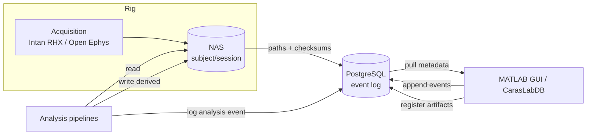

# Lab Metadata System — Overview

---

## Purpose

A metadata and provenance layer for an extracellular electrophysiology lab. The
system records *what happened* (births, surgeries, recordings, analyses) as an
append-only log and treats files on the NAS as artifacts produced by those
events. Raw and derived data are never the source of truth about the experiment;
the event log is.

Design goals:

- **Provenance.** Every derived file traces back through the analysis that
  produced it, its inputs, and the recording and subject it came from.
- **Reproducibility.** Analysis events carry the pipeline name, code version,
  parameters, and input artifacts needed to rerun them.
- **Auditability.** Events are immutable. Mistakes are corrected by appending a
  superseding event, not by editing history, and the database records which
  person's login wrote every row.

## Design philosophy: events, not files

The schema is organized around immutable events rather than around files.

- An **event** is a fact that occurred at a point in time (a birth, a surgery, a
  recording, an analysis run). Events are append-only.
- An **artifact** is a file produced by an event, referenced by its path on the
  NAS plus a checksum. Artifacts are metadata rows; the bytes live on the NAS.
- **Provenance** is the directed acyclic graph formed by events producing
  artifacts and analysis events consuming artifacts to produce new ones.

A file being renamed, moved, or re-derived does not change what happened in the
lab. Separating the two makes provenance tractable and makes reruns a matter of
reading an analysis event rather than reverse-engineering a folder.

## Components

| Component | Role |
|---|---|
| PostgreSQL database | Append-only event log, artifact index, provenance graph, tag and variable definitions and their value logs, retractions, file dispositions |
| NAS storage | Actual data, laid out as `subject/session/...` |
| MATLAB class (`CarasLabDB`) | Programmatic push/pull between MATLAB and the database, including tagging (`addTag`, `setTag`, `findByTags`, ...), variables (`setVariable`, `getVariables`, ...), retraction (`retractEvent`, `retractArtifact`) and file dispositions (`addArtifactDisposition`) |
| MATLAB GUI (`@CarasLabDBApp`, a `uifigure` app) | Interactive metadata entry and browsing for the lab, with a tag filter, per-row tag (Ctrl+T) and variable (Ctrl+L) editors, retraction, file dispositions (Ctrl+Shift+F), a daily husbandry grid and the integrity report |
| Web dashboard (`web/lab-dashboard.html`) | Standalone HTML/JS visualization of the data model, rendered from in-page synthetic data with no backend (charts load Chart.js from a CDN) |
| Live dashboard (`web/live/`) | The same UI backed by the real database through a small `/api/data` server |
| Forms (`web/forms/`) | A browser page for building data-entry templates and entering one session of one subject on them, under each member's own login, with a CSV file per subject per project kept up to date ([forms.md](forms.md)) |
| MCP server (`mcp-server/`) | Read-only Model Context Protocol server giving an LLM agent typed `get*` query tools over the schema, including tag and variable lookups |
| Tools (`tools/`) | Backup and restore of the database and its roles (`backup_lab.py`, `restore_lab.py`), and the scheduled check of the NAS files against their checksums (`verify_artifacts.py`) |

MATLAB target: R2024b or newer, with the Database Toolbox. The class connects
through the toolbox's **native `postgresql()`** interface, so no ODBC DSN and no
JDBC driver `.jar` need to be installed or configured. See
[Database design](database-design.md) for the table-by-table model and
[MCP server](mcp-server.md) for the agent-facing interface,
[Tagging](tagging.md) for the tag system and [Variables](variables.md) for
user-defined variables. The lab's production deployment is on a Windows 11
server ([deployment guide](deployment-windows.md)).

## Data flow

## Core concepts

- **Subject.** The animal, identified by a lab ID. Identity is independent of
  birth: an acquired animal has a subject row but may have no birth event.
- **Session.** A recording period, mapping one-to-one to a NAS folder
  (`subject/session`). Groups the recording events of that period.
- **Correction.** An event that supersedes an earlier one via a `supersedes`
  link. The original row is retained; queries filter to the active version.
- **Retraction.** The withdrawal of an event or artifact that should never
  have been recorded (entered twice, registered by mistake), with a reason.
  The row stays in the database but is no longer active; superseding it
  later brings it back.
- **File disposition.** What became of a registered file: replaced (other
  bytes at its path now), moved, deleted, or restored. The artifact row stays
  a true record of what was produced, so analyses that read the file keep
  pointing at it; the disposition says where the file is now. Like a
  verification it belongs to the file, not to one row.
- **Provenance DAG.** The graph of `event → artifact → analysis → artifact`.
  See the recursive lineage query in [Database design](database-design.md).
- **Tag.** A hashtag-style `namespace:value` label (`stage:raw`, `cohort:a`,
  `qc:fail`; a bare `auditory_cortex` is `tag:auditory_cortex`) on an event,
  artifact, subject, session or project, for categories that change or cut
  across the fixed columns. Each namespace declares whether its tags can later
  change, whether an entity may carry one or several, and where they apply.
  Like events, tag assignments are an append-only log; an entity's current
  tags are derived from it, and a correction carries its predecessor's tags
  forward. See [Tagging](tagging.md).
- **Variable.** A user-defined named value (`probe depth` = 1200 µm on a
  session) on any of the same five kinds of entity, for measurements and
  settings no fixed column anticipates. One number (with units) or one piece
  of text; setting it again is an update and the history is kept; a
  correction carries it forward. See [Variables](variables.md).
- **Form.** A named, reusable data-entry template, built in the browser and
  put to use for a subject in a project. Each entry made on it is an
  `observation` event whose field values are variables on the event, plus a
  note that can be changed later; for each subject in each project the
  entries are also kept as one CSV file. See [Forms](forms.md).
- **Login and person.** Every lab member connects with their own database
  login. The database stamps that login on each row it stores and maps it to
  the member's `person` row (`lab.person.db_login`), so who entered what does
  not depend on the client telling the truth.

## Scope and assumptions

- One shared database serves the lab; PostgreSQL is assumed for concurrent
  multi-user access. The schema is portable; SQLite is viable only for
  single-writer use.
- The NAS is mounted on each workstation. Artifact paths are stored relative to
  a configured NAS root so they resolve across machines and OSes.
- Acquisition software (Intan RHX, Open Ephys) and analysis pipelines (e.g.
  Kilosort) are external. The system records their outputs and parameters; it
  does not run them.

